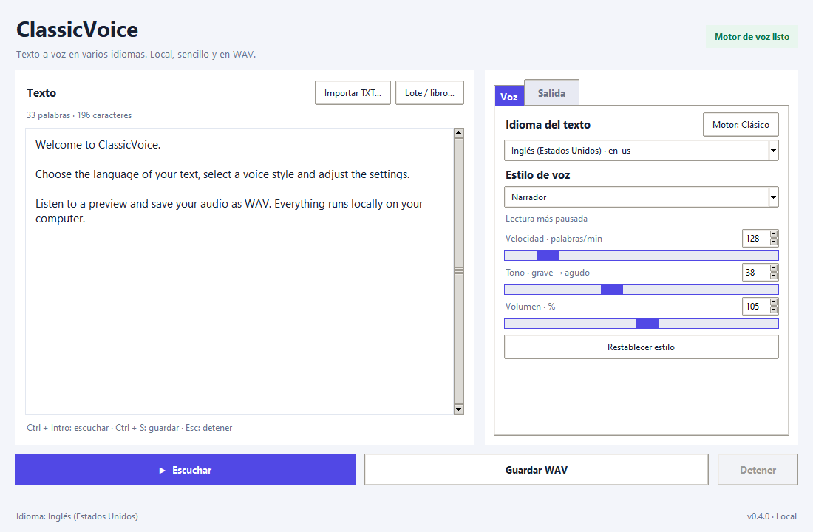
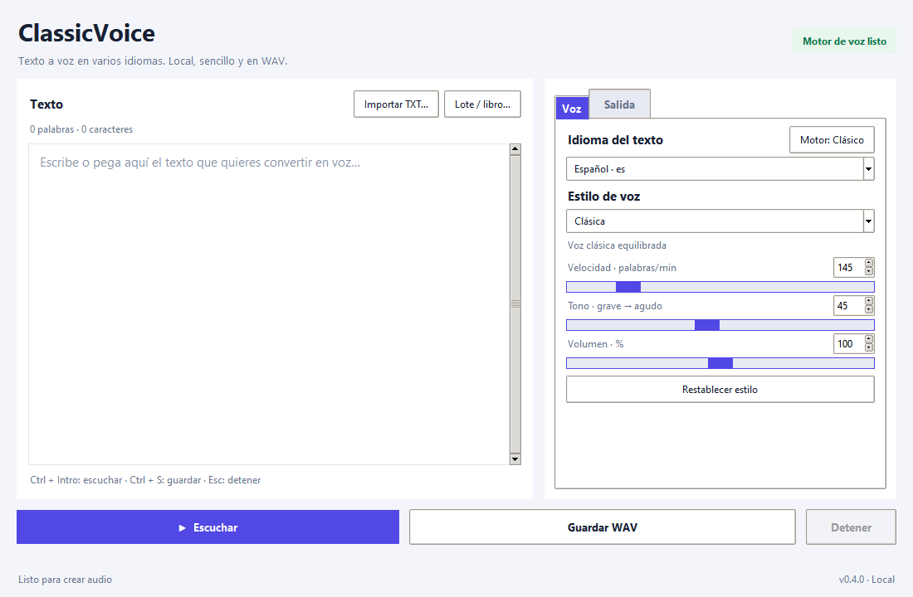
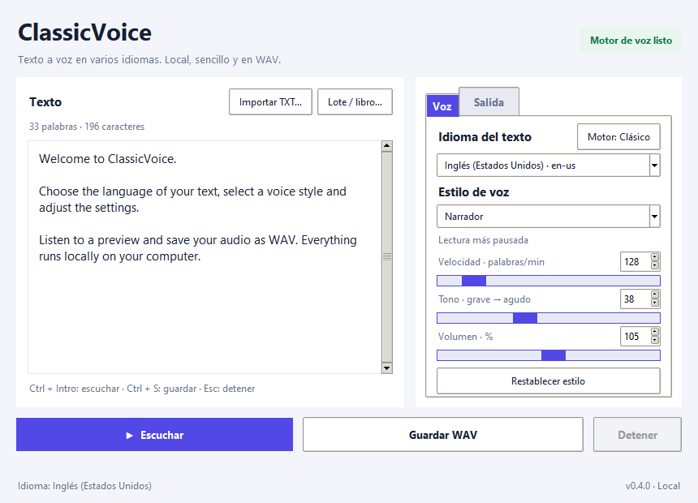
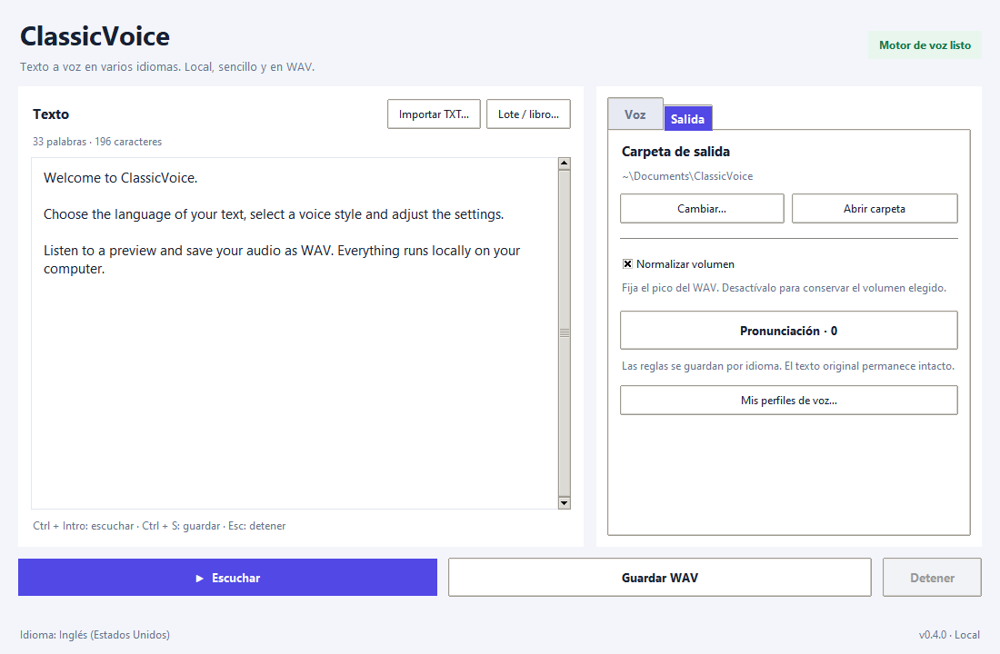
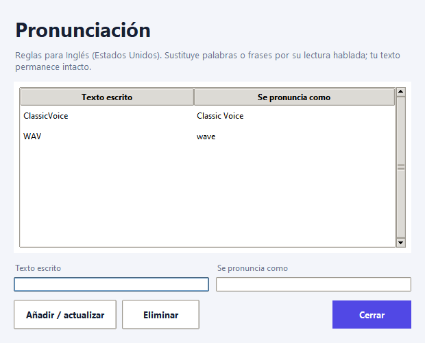
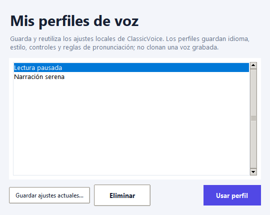
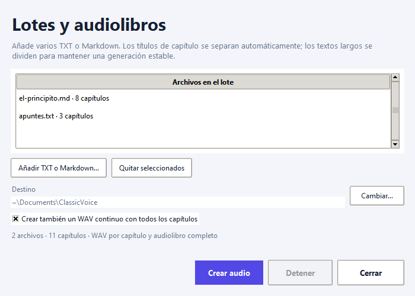
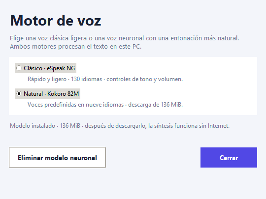
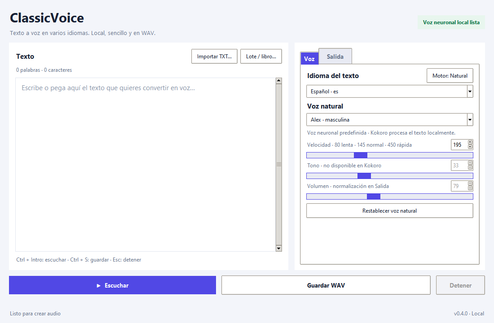

<p align="center">
  
</p>

<h1 align="center">ClassicVoice</h1>

<p align="center"><strong>Multilingual text to speech. Local, simple, and exported as WAV.</strong></p>

<p align="center">
  <a href="https://github.com/smouj/classicvoice/releases/latest"></a>
  <a href="https://github.com/smouj/classicvoice/actions/workflows/ci.yml"></a>
  <a href="https://github.com/smouj/classicvoice/stargazers"></a>
  <a href="https://github.com/smouj/classicvoice/blob/main/LICENSE"></a>
  <a href="https://github.com/smouj/classicvoice/releases"></a>
</p>

<p align="center"><a href="README.md">Español</a> · <a href="https://github.com/smouj/classicvoice/releases/latest">Download for Windows</a></p>

ClassicVoice turns text into speech from a Windows desktop app. Use **eSpeak NG** for a fast, lightweight classic voice or optionally install **Kokoro**, a local neural engine with more natural intonation. Choose a language and voice, preview it, and save a WAV file.

The classic engine includes **130 languages and regional variants**. Kokoro offers preset neural voices in **9 languages**, including Spanish. The language selector lists only languages supported by the chosen engine. ClassicVoice reads the text in that language and does not translate it. See the [language catalog](docs/IDIOMAS.md).

**Speech is processed locally.** The classic engine needs no model or internet connection. Kokoro is optional: download it once from the app (about 136 MiB) and it will also work offline. No account or API key is needed; ClassicVoice does not send your text or collect telemetry.

On older computers, natural synthesis can take longer than the resulting audio. The window remains responsive, and the classic engine is still available for fast output.

> ClassicVoice provides classic synthetic voices. It does not include or imitate proprietary Loquendo voices.

## App screenshots

The actual ClassicVoice desktop interface on Windows, with English sample text and the Narrador voice style:



<details>
<summary>More screens: settings, pronunciation, profiles, and audiobooks</summary>

**Initial screen**



**Compact window without page scrolling**



**Output settings**



**Sample pronunciation rules**



**Reusable voice profiles**



**Chapter batch and audiobook queue**



**Natural neural engine**



**Editor with a selected Kokoro voice**



[Listen to a short Spanish natural-voice sample](assets/samples/classicvoice-natural-es.wav) · Kokoro · Dora voice.

</details>

## Install on Windows

1. Download `ClassicVoice-<version>-windows-x64.zip` from [Releases](https://github.com/smouj/classicvoice/releases/latest).
2. Extract the ZIP to a folder of your choice.
3. Open that folder and double-click **Install-ClassicVoice.bat**.
4. ClassicVoice appears on your desktop and in the Start menu. Installation is per-user and does not require administrator rights.

The package includes the application, both engine runtimes, and their license notices. The neural model is optional and not bundled; download it from ClassicVoice without administrator privileges. Python is not required. You can also run `ClassicVoice\ClassicVoice.exe` directly from the extracted folder as a portable copy.

See the [installation guide](docs/INSTALACION.md) for updates, uninstall steps, and troubleshooting.

## Quick start

1. Type or paste text into the editor.
2. In **Voz**, choose an engine. **Classic** includes 130 languages and pitch/volume controls. For more natural voices, open **Motor: Natural**, download the model once, and select a Kokoro language and voice.
3. Press **Escuchar** to preview. **Detener** stops playback.
4. Press **Guardar WAV** and choose a file name and location.

In **Salida**, change or open the output folder, normalize the audio peak, and edit pronunciation rules for the selected language. **Mis perfiles de voz** saves the engine and its settings. **Lote / libro** renders chapter WAVs and can also make one continuous audiobook WAV. Preferences persist; an active queue does not survive app exit. The interface resizes without page scrolling. See the [user guide](docs/GUIA_DE_USO.md) for controls and troubleshooting.

## Features

- Classic selector with 130 languages and regional variants.
- Optional Kokoro ONNX with preset neural voices in Spanish, English, French, Italian, Brazilian Portuguese, Japanese, Mandarin Chinese, and Hindi.
- Four classic styles with speed, pitch, and volume controls; speed and natural voice controls for Kokoro.
- Resizable editor, TXT import and voice/output settings tabs.
- Responsive interface, background synthesis, preview, and stop control.
- Validated WAV export with optional peak normalization.
- Pronunciation replacement rules per language and per-user saved preferences.
- Reusable voice-setting profiles with per-language pronunciation rules.
- Batch rendering of TXT/Markdown chapter files to separate WAVs, with optional merged audiobook output.
- Automatic chapter detection and bounded splitting of long texts; cancellation removes incomplete output.
- SHA-256-pinned model downloads with safe cancellation and in-app removal.
- Kokoro inference capped at two CPU threads; the model is stored in LocalAppData and never runs in the background.
- Windows desktop package with the runtimes and eSpeak NG; the optional model downloads separately.

## Privacy and licensing

ClassicVoice never sends your text and has no telemetry. The classic engine makes no network requests. Only when you choose to install Kokoro does the app download its files from GitHub and verify their SHA-256 hashes; synthesis then remains local. ClassicVoice is MIT-licensed. See [THIRD_PARTY.md](THIRD_PARTY.md) for third-party licenses and source notices.

## Build from source

Requirements: Windows x64, Python 3.11, and PowerShell.

```powershell
.\tools\build_windows.ps1
.\tools\build_windows.ps1 -Install
```

For source development without building the executable:

```powershell
py -3.11 -m pip install -e ".[test,natural]"
py -3.11 -m classicvoice
py -3.11 -m pytest
```

The build installs the optional Kokoro runtimes and downloads the official eSpeak NG 1.52.0 MSI; it verifies the hash and extracts the files without installing the engine system-wide. Kokoro model weights are not included in the build.

## Project

- [Changelog](CHANGELOG.md) · [Scope](docs/SCOPE.md) · [Architecture](docs/ARCHITECTURE.md) · [Contributing](CONTRIBUTING.md) · [Security](SECURITY.md)
- Issues and feature requests: [GitHub Issues](https://github.com/smouj/classicvoice/issues)
- Source: [smouj/classicvoice](https://github.com/smouj/classicvoice)

<p align="center">Created by <a href="https://github.com/smouj">smouj</a> · ClassicVoice 0.4.0 · MIT</p>
