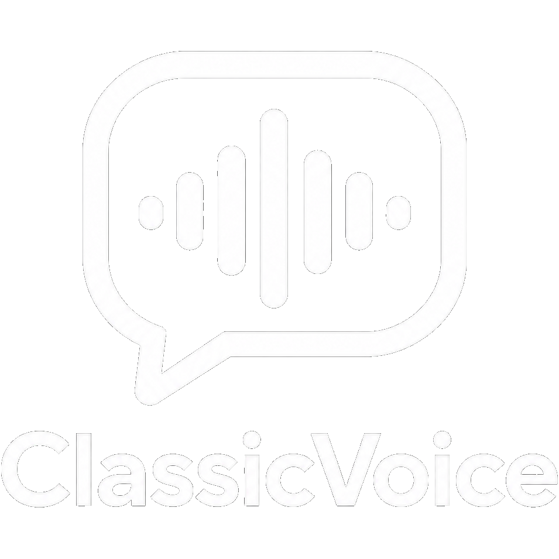

<table align="center" bgcolor="#151722"><tr><td align="center">
  
</td></tr></table>

<h1 align="center">ClassicVoice</h1>

<p align="center"><strong>Texto a voz clásico en español. Local, sencillo y en WAV.</strong></p>

<p align="center">
  <a href="https://github.com/smouj/classicvoice/releases/latest"></a>
  <a href="https://github.com/smouj/classicvoice/actions/workflows/ci.yml"></a>
  <a href="https://github.com/smouj/classicvoice/stargazers"></a>
  <a href="https://github.com/smouj/classicvoice/blob/main/LICENSE"></a>
  <a href="https://github.com/smouj/classicvoice/releases"></a>
</p>

<p align="center"><a href="README.en.md">English</a> · <a href="https://github.com/smouj/classicvoice/releases/latest">Descargar para Windows</a></p>

ClassicVoice convierte texto en voz sintética en español usando **eSpeak NG**. Escribe, ajusta una voz, escucha una vista previa y guarda el resultado como WAV desde una aplicación de escritorio para Windows.

**Todo el procesamiento de voz se realiza localmente.** La aplicación no requiere cuenta, clave API, conexión a Internet ni modelos de IA.

> ClassicVoice ofrece voces sintéticas clásicas. No incluye ni imita las voces propietarias de Loquendo.

## Capturas de la aplicación

Interfaz real de ClassicVoice en Windows, con texto de ejemplo y el preset Narrador:


<details>
<summary>Ver la pantalla inicial y el diccionario de pronunciación</summary>

**Pantalla inicial**


**Reglas de pronunciación de ejemplo**


</details>

## Instalar en Windows

1. Descarga `ClassicVoice-<versión>-windows-x64.zip` desde [Releases](https://github.com/smouj/classicvoice/releases/latest).
2. Extrae el ZIP en una carpeta de tu elección.
3. Abre esa carpeta y haz doble clic en **Install-ClassicVoice.bat**.
4. ClassicVoice quedará disponible en el escritorio y en el menú Inicio. El instalador es por usuario y no necesita permisos de administrador.

El paquete contiene la aplicación, el motor de voz eSpeak NG y sus avisos de licencia. No necesitas instalar Python. También puedes ejecutar `ClassicVoice\ClassicVoice.exe` directamente desde la carpeta extraída para probar la versión portátil.

Consulta la [guía de instalación y actualización](docs/INSTALACION.md) si necesitas más detalle o ayuda para desinstalar.

## Uso rápido

1. Escribe o pega el texto en el editor.
2. Elige uno de los cuatro presets y ajusta velocidad, tono y volumen.
3. Pulsa **Escuchar** para previsualizar la voz; **Detener** interrumpe el audio.
4. Pulsa **Guardar WAV** y elige el nombre y la ubicación del archivo.

Puedes crear reglas de pronunciación y normalizar el volumen antes de guardar. Los ajustes se recuerdan para la próxima vez. Usa **Ctrl + A** para seleccionar todo el texto y **Esc** para detener la voz. En ventanas pequeñas aparece una barra de desplazamiento para acceder a todos los controles. La [guía de uso](docs/GUIA_DE_USO.md) explica cada control y resuelve problemas frecuentes.

## Qué incluye

- Cuatro presets sintéticos de español y controles independientes de velocidad, tono y volumen.
- Interfaz que sigue respondiendo mientras sintetiza, con controles de previsualización y detención.
- Exportación WAV validada y normalización de pico opcional.
- Reglas de reemplazo de pronunciación y guardado de preferencias por usuario.
- Paquete de escritorio con eSpeak NG y datos de voz incluidos.
- Código de la aplicación basado en la biblioteca estándar de Python; PyInstaller solo se utiliza para crear el paquete de Windows.

## Privacidad y licencias

La aplicación instalada no realiza solicitudes de red. La descarga de eSpeak NG solo ocurre durante la compilación del paquete, desde su publicación oficial y con una comprobación SHA-256 fijada. ClassicVoice usa licencia MIT; eSpeak NG conserva su licencia GPL-3.0-or-later y sus avisos y código fuente se incluyen en el paquete. Consulta [THIRD_PARTY.md](THIRD_PARTY.md).

## Compilar desde el código

Requisitos para crear la versión de escritorio: Windows x64, Python 3.11 y PowerShell.

```powershell
.\tools\build_windows.ps1
```

Para compilar, instalar en el perfil actual y verificar la exportación WAV:

```powershell
.\tools\build_windows.ps1 -Install
```

Para desarrollar la aplicación sin crear el ejecutable:

```powershell
py -3.11 -m pip install -e ".[test]"
py -3.11 -m classicvoice
py -3.11 -m pytest
```

La primera compilación descarga el MSI oficial de eSpeak NG 1.52.0, comprueba su hash y extrae los archivos sin instalar el motor para todo Windows.

## Proyecto

- [Cambios por versión](CHANGELOG.md) · [Alcance](docs/SCOPE.md) · [Arquitectura](docs/ARCHITECTURE.md) · [Contribuir](CONTRIBUTING.md) · [Seguridad](SECURITY.md)
- Problemas y propuestas: [GitHub Issues](https://github.com/smouj/classicvoice/issues)
- Código: [smouj/classicvoice](https://github.com/smouj/classicvoice)

<p align="center">Creado con cuidado por <a href="https://github.com/smouj">smouj</a> · ClassicVoice 0.2.2 · MIT</p>
